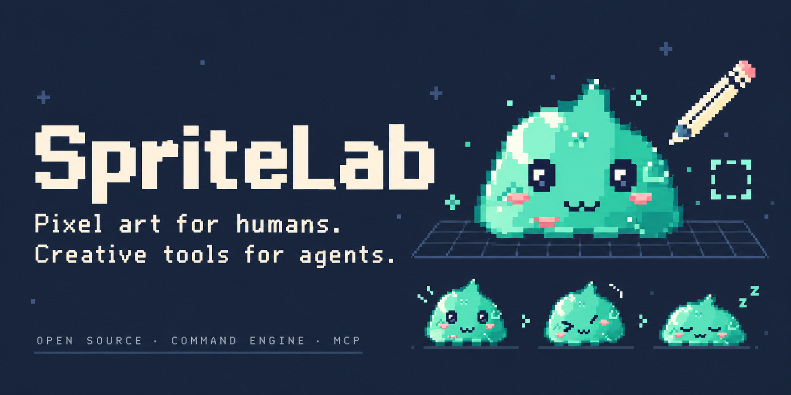
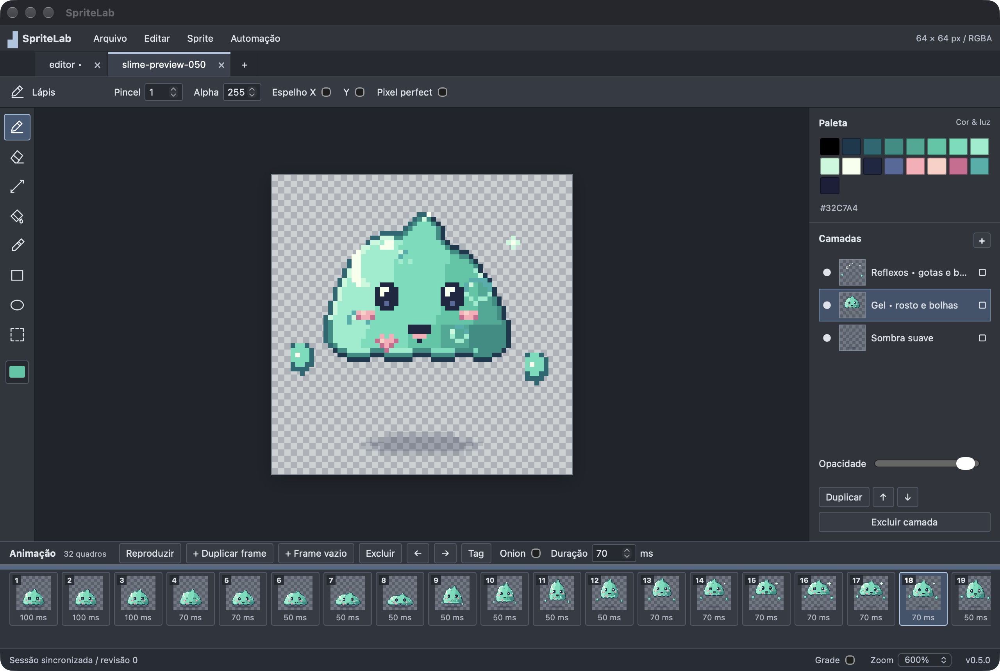
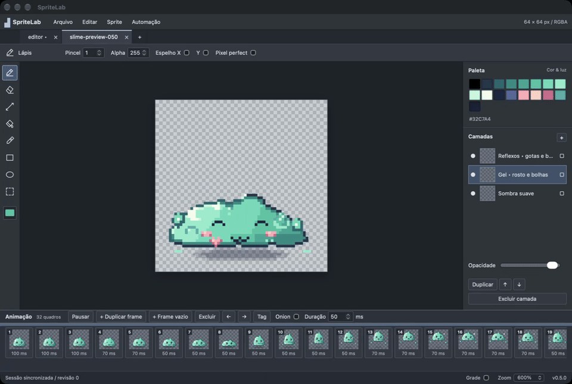

# SpriteLab



[](https://github.com/jose-pires-neto/SpriteLab/actions/workflows/ci.yml) [](LICENSE) [](https://github.com/jose-pires-neto/SpriteLab/releases)

**Pixel art for humans. Creative tools for agents.**

SpriteLab is an original, MIT-licensed pixel-art and animation editor with a Rust Command Engine. The desktop UI, CLI, Python scripts and MCP agents execute the same operations. MCP is an adapter; removing it does not remove editing capability.

**0.5.0 is an experimental preview**, not a complete Aseprite replacement. macOS arm64 desktop is validated locally; headless macOS/Linux and macOS desktop builds run in CI. No Windows desktop/session support is claimed. We are building the first editor in the proposed AssetForge ecosystem, not a 3D editor or asset database yet.

## See it in action



| Slime Menta benchmark | Editable project |
| --- | --- |
|  | 64×64 · 3 layers · 32 frames · 2.1 s loop. Original detached buffers were committed through MCP to the same Rust engine used by the GUI. [Open the example](examples/slime-menta/README.md). |

[Watch the real editor recording (8 seconds)](docs/media/editor-slime-demo.mp4) · [Watch the exported animation (MP4)](docs/media/slime-menta-animation.mp4). The screenshot is an actual desktop capture; the cover is AI-assisted promotional art inspired by the original mascot. It is not an engine-rendered screenshot or a benchmark result.

<details>
<summary>Play the real editor recording as a GIF</summary>



</details>

## Try it

Download the macOS arm64 portable preview from [Releases](https://github.com/jose-pires-neto/SpriteLab/releases). Extract the ZIP, verify its checksum and open `Open SpriteLab.command` or `SpriteLab.app`. Optional installation and MCP registration are documented in [Quick start](docs/QUICKSTART.md).

The app is a debug build, locally ad-hoc signed; it is **not Developer ID signed or notarized**. No Rust/npm setup is needed to open the downloaded GUI. MCP requires Node 22.19+ and your agent host. No online AI service or API key is required by SpriteLab itself.

## What works

- RGBA documents, ordered layers with per-layer thumbnails, sparse cels, frame duplication/reorder/duration, forward tags and animation playback.
- Pencil/eraser/line/fill/eyedropper, rectangles/ellipses, rectangular selection/transforms, alpha, brush size, symmetry, pixel-perfect strokes, grid and onion skin.
- Undo/redo, atomic edit batches, revision guards, bounded resources and automatic desktop recovery checkpoints.
- Editable `.spritelab` JSON, PNG import/preview/export, animated GIF and row-major spritesheet export with metadata.
- 50 typed operations with generated schemas, real CLI/Python/MCP parity tests, shared desktop sessions over private Unix sockets and independent headless sessions.

## Build from source

Install Rust 1.88+, Node 22.19+, Python 3 and the [Tauri platform prerequisites](https://v2.tauri.app/start/prerequisites/).

```sh
cargo build -p spritelab-cli --locked
npm ci --ignore-scripts --prefix adapters/mcp
npm ci --ignore-scripts --prefix apps/desktop
./scripts/build-desktop.sh
```

Scripts use Cargo on PATH; an optional delivered toolchain under `work/toolchain` is only a local convenience. The repository contains committed lockfiles. `./scripts/package-preview.sh` builds a portable macOS arm64 preview with GUI, CLI, MCP dependencies, notices and checksum.

## Use with agents

Open SpriteLab before connecting live MCP. The default workspace is `~/Documents/ChatGPT/SpriteLab/assets`. From a source checkout or your final extracted/installed preview location:

```sh
node scripts/configure-mcp.mjs --workspace "$HOME/Documents/ChatGPT/SpriteLab/assets"
```

This registers `spritelab_live` and `spritelab_headless` in Codex. `--print` emits JSON for another MCP host. Paths are discovered on your machine, not hardcoded to a developer's account. Reconnect after moving the installation or restarting the editor. Project-local Codex settings can override global registrations.

- **Live** attaches to the newest running session in the selected workspace. Confirm `editor.inspect`, document ID and revision before editing, especially with multiple windows.
- **Headless** starts an independent engine. It does not edit the GUI's open documents.
- Supply `expected_revision` on edits/history. Conflicts fail explicitly; no automatic merge or mutation retry exists.
- `document.preview` returns a PNG; optional `layer_id` inspects isolated layer content. Save the editable project separately from exports.

See [MCP/session guide](docs/MCP-SESSAO.md), [protocol](docs/PROTOCOL.md) and [generated catalog](docs/commands.json).

## CLI / Python

```sh
mkdir -p demo
./target/debug/spritelab --workspace demo <<'JSONL'
{"document_id":"example","command":"document.create","args":{"width":32,"height":32}}
{"document_id":"example","expected_revision":0,"command":"canvas.stroke","args":{"layer_id":1,"frame_id":2,"points":[[8,8],[23,23]],"color":[242,104,68,255]}}
{"document_id":"example","command":"document.save","args":{"path":"example.spritelab","overwrite":false}}
{"document_id":"example","command":"export.png","args":{"path":"example.png","frame_id":2,"overwrite":false}}
JSONL
python3 examples/generate_mushrooms.py --engine ./target/debug/spritelab --workspace demo
```

File paths are relative to the workspace; parent directories must exist. A new document starts with layer 1/frame 2; inspect returned IDs after edits/reopen. Request IDs correlate responses, not durable idempotency. The example composes detached original pixel buffers and commits them through engine commands.

## Known limits

512×512, 32 layers, 64 frames, four open documents and 524,288 allocated cel pixels. History retains up to 32 entries with a conservative 32 MiB estimate. Recovery covers completed checkpoints every 15 seconds; the latest interval, undo and viewport are not recovered. No power-loss durability guarantee.

No lasso/masks, OS clipboard, indexed-color editing, custom brushes, linked-cel semantics, blend groups, tilemaps/slices, `.aseprite` I/O, packed atlas or reverse/ping-pong playback yet. No streaming events, long-running jobs/cancellation, transparent reconnect, GPU renderer or plugin ABI. See [coverage](docs/COBERTURA.md), [compatibility](docs/COMPATIBILITY.md) and [roadmap](docs/ROADMAP.md).

## Contribute

Read [CONTRIBUTING](CONTRIBUTING.md), [architecture](docs/ARCHITECTURE.md), [ADRs](docs/adr) and [security policy](SECURITY.md). File reproducible bugs with OS, version, adapter and a minimal safe sample. CI checks engine behavior, real adapters, schema drift and desktop compilation. A passing headless suite is not evidence of exhaustive GUI/platform validation.

Original code/assets use [MIT](LICENSE). Dependencies retain their own [notices](THIRD_PARTY_NOTICES.md). Aseprite/Photoshop are workflow references, not dependencies; no Aseprite implementation, artwork, palettes, fonts or icons are included. Research records describe observed architecture and explicitly distinguish evidence from future plans.
