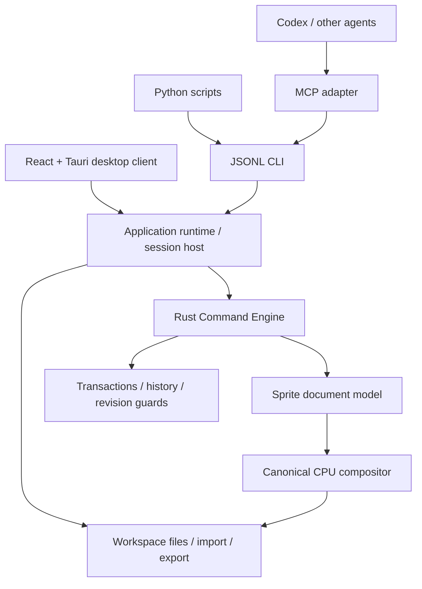

# Architecture

Status: initial executable foundation and accepted product direction, 2026-10-13.

## Governing decision

The Command Engine owns all durable asset operations. MCP is a transport adapter. Closing or removing MCP must not remove any editing capability from the engine or CLI. The Tauri UI selects parameters and presents results from this same boundary.

The Tauri UI owns a Runtime behind a shared mutex. CLI/MCP use headless mode or attach to that same runtime through a private Unix socket. The session host lives in spritelab-cli::session and uses the existing request/response envelopes. Editor view context and saved-state tracking are runtime services, distinct from asset history.

## Existing module boundaries

| Module | Responsibility | Forbidden dependency |
|---|---|---|
| `assetforge-command` | Request/response/error/descriptor contracts and protocol version | Raster data, Tauri, MCP, filesystem policy |
| `spritelab-core` | Raster domain model, typed edits, rendering, revision/history and atomic edit dispatch | React, MCP, OS files, web services |
| `spritelab-cli` library | One application runtime, workspace file policy, project/PNG I/O, atlas export | UI state or model-provider APIs |
| `spritelab` binary | Bounded JSONL input/output and session lifetime | Painting algorithms |
| `adapters/mcp` | MCP discovery, protocol adaptation, images/resources and owned CLI process | Domain mutation/history rules |
| Python examples | Compose calls, receive IDs, orchestrate batch jobs | Independent raster editing of persisted documents |

The Python mushroom example constructs an input buffer outside the engine; the engine validates and commits that buffer through `canvas.patch`. Such detached-buffer generation is allowed. Clients never mutate an engine-owned document buffer directly.

## Intent, mutation, rendering

A public command describes user intent. An edit applies domain changes to a draft. History records the resulting asset state. Rendering reads authoritative document state. Those are related responsibilities but not the same abstraction.

For the prototype, an edit draft shallow-clones frame buffers via `Arc`; writes clone only the affected cel. A batch applies at most 256 edits to one draft, validates each intermediate domain state and publishes once. Failure discards the draft and tentative IDs. A successful batch is one revision and undo entry. No-op batches preserve revision and redo. This intentionally rejects temporarily invalid intermediate states.

Undo/redo restore document state while incrementing session revision. The ID allocator stays monotonic during the session, including after undo. Closing/reopening starts a new session revision and allocator inferred from current saved objects; session references must not be reused across that boundary.

The prototype's copying cost remains per affected dense cel and its history budget estimate counts complete snapshot pixels conservatively. Production history should store validated region/tile patches with structural patches for layers, cels, frames and metadata. That change is behind the command boundary and does not change CLI/MCP/UI APIs.

## Document model

A sprite document has a domain kind and file-format version, dimensions, ordered layers, ordered stable-ID frames, palettes and tags. A frame has duration and sparse layer-to-cel entries. An absent cel is transparent. A present prototype cel is a full-canvas RGBA buffer. Duplicated frames share buffers internally until edited, then detach.

This is storage sharing, **not user-visible linked cels**. Future cel records need their own IDs, bounds/position/opacity and an independent image store. Linked editing must explicitly select `edit_shared` or `unlink_before_edit`; default behavior cannot be inferred from incidental pointer sharing. Stable frame IDs are used in tags, and later frame removal/reorder commands must define tag adjustment in the domain engine.

The canonical renderer composites visible layers in their stored order using normal source-over, layer opacity and integer RGBA arithmetic on stored sRGB bytes. GPU display must match canonical export pixels for the supported color modes; display color management and editor overlays are separate concerns. More blend modes, indexed formats and color profiles require explicit domain and render tests.

## UI contract and stroke lifetime

Tauri commands invoke the Rust `Runtime` directly, returning the same responses used by CLI/MCP. React owns zoom, pan, hover, active tool and temporary view state. React must not own authoritative pixels, palette transformations or tag adjustment logic.

The current GUI submits `command.preview {edit, frame_id}` against a detached Rust document clone. The same `apply` function renders preview and commit; previews do not change revisions, history or ID allocation. Pointer-up submits one stroke/line edit, and cancellation drops the sampled gesture.

Next, introduce `stroke.begin/update/preview/commit/cancel` in a single session host. The core owns a temporary overlay and deterministic raster kernel; update does not publish a document revision. Commit publishes one transaction. Agents can submit all points through the existing `canvas.stroke`; streamed GUI input must produce the same resulting stroke. Coordinate conversion from screen to integer canvas coordinates happens before dispatch. Keep nearest-neighbor display and avoid half-pixel blurring.

A Command Palette and automation inspector are views of the authoritative command registry. Dialogs collect required parameters; command enabled states may depend on a query but never perform mutations themselves. Ephemeral viewport changes need not enter asset undo history. If exposed to automation, register them as client/session view operations with distinct effects.

## Serialization and concurrent editing

The host serializes all attached clients through the runtime mutex. `expected_revision` is an optional optimistic concurrency guard; automation should supply it on edits and history operations. Two requests targeting the same old revision cannot both commit. This is not collaborative editing or merge semantics.

The current local session service is the single writer for its open documents. GUI calls it in process; CLI/MCP attach through a Unix socket restricted to the OS user. CLI may also run an isolated headless host. Choose explicit `attach` versus `headless` modes. No adapter may open the same project and assume shared memory with another process. Shared-session human/agent command parity and stale-revision rejection are tested. Scheduling, ownership notifications and graceful reconnection remain production requirements.

Request IDs correlate responses today. Durable idempotency requires bounded stored request outcomes tied to request content, session/document identity and revision. Cancellation of a job must have a declared commit point; killing an adapter is not proof that an external write rolled back.

## Persistence and side effects

`.spritelab` v1 is documented JSON for this foundation. It stores editable asset content, not UI state, live revision or history. All imports validate identities, dimensions, cel references and buffers before installation. Unsupported versions fail closed. A future container may store a manifest and deduplicated image blobs; migrate explicitly instead of silently reinterpreting JSON.

File commands execute at the runtime's workspace boundary. Read paths are bounded and canonicalized; write paths require existing parents within the root and explicit overwrite. Save/PNG export stages bytes into a sibling temporary file, syncs it, then publishes. No-overwrite uses a hard link to avoid replacing an existing file in a race. Save/export are not undoable document edits. They are not admitted to `command.batch`. Atlas writes one PNG and returns its metadata; the Python example saves that JSON separately. The pair is not promised to be an atomic multi-file export.

Before release, add crash recovery, cross-process ownership, robust directory synchronization/platform handling and a staged multi-artifact publish protocol. Readers/writers of third-party formats report unsupported features instead of silently flattening them.

## AssetForge evolution

Share **command contracts, registry, scheduling, transaction/history interfaces, job management, persistence facilities and asset catalog**, while giving each domain its own data and kernels.

- SpriteLab: layers, cels, pixels, raster animation and atlas recipes.
- Future 3D editor: scenes, meshes, materials, skeletal animation, geometry patches and its own renderer.
- Pipeline/catalog: asset IDs, source/dependency digests, tags, recipes, importers, exporters, cache keys and provenance.

A 3D mesh is not a sprite document with extra fields. A shared asset envelope can carry `asset_id`, `domain_kind`, `schema_version`, dependency references and metadata; the domain payload is separately versioned. Register domain capabilities, not UI tool names. Namespace future geometry operations (`mesh.*`, `material.*`, `scene.*`) and retain versioned SpriteLab raster commands.

At this stage, `assetforge-command` is reusable and the raster engine is independent. A generic multi-domain engine host, plugin ABI and catalog are not implemented. Extract proven session/history services into an `assetforge-engine` crate when adding a second in-process domain or live session host; preserve the contract boundary and parity suite. Rust-native plugins need a deliberate ABI/isolation strategy. Do not freeze a dynamic-library ABI based on the first raster prototype.

See the [Aseprite evidence map](research/aseprite-source-map.md) for observations that informed these choices. This architecture is an original design; source observations are not a claim of measured equivalence with Aseprite.
